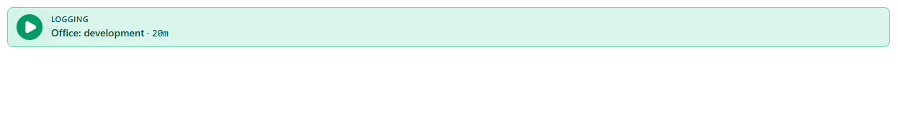
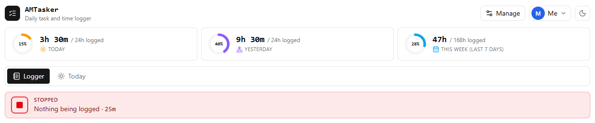
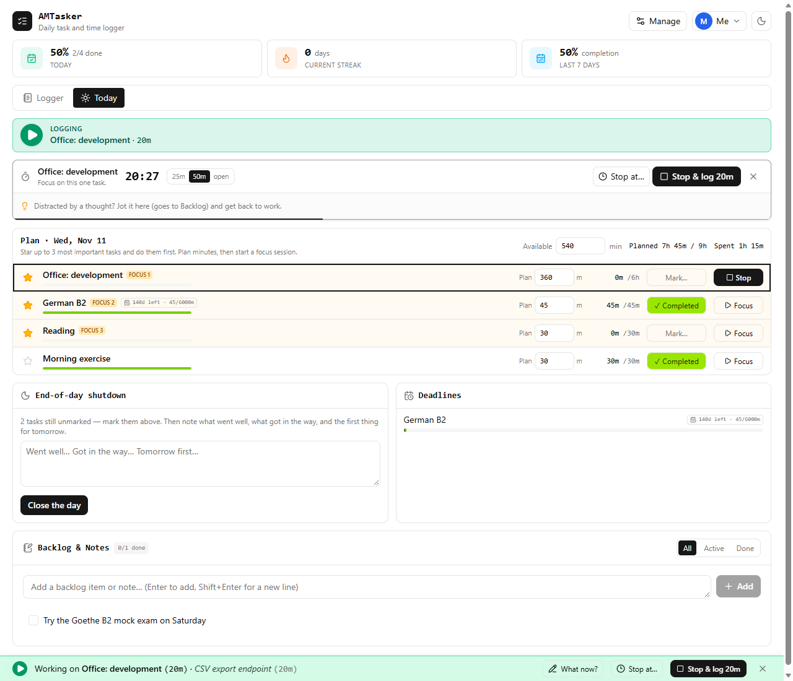
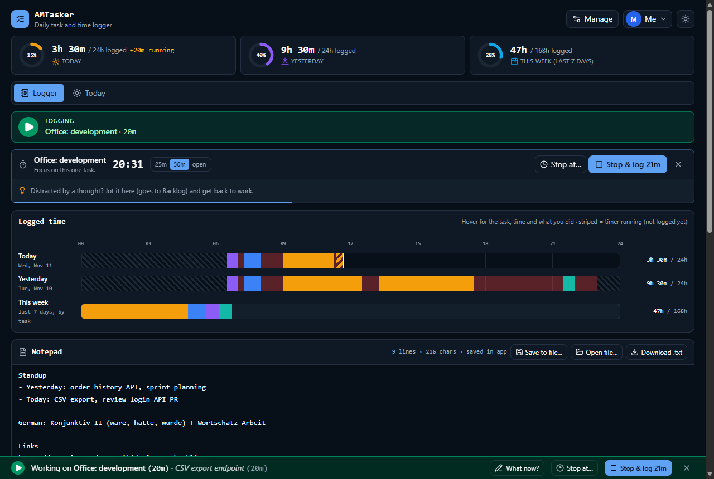

<div align="center">


# AMTasker

**A local-first daily task and time logger. See at a glance whether your time is being logged.**

[](https://github.com/asadmshah3/AMTasker/actions/workflows/ci.yml)
[](LICENSE)
[](https://nodejs.org/)
[](https://nextjs.org/)
[](https://www.typescriptlang.org/)

[**Live demo**](https://asadmshah3.github.io/AMTasker/) ·
[**User guide**](docs/USER_GUIDE.md) ·
[Report a bug](https://github.com/asadmshah3/AMTasker/issues/new?template=bug_report.yml) ·
[Request a feature](https://github.com/asadmshah3/AMTasker/issues/new?template=feature_request.yml)


</div>

## Table of contents

- [Why AMTasker](#why-amtasker)
- [Features](#features)
- [Screenshots](#screenshots)
- [Getting started](#getting-started)
  - [Linux](#linux)
  - [macOS](#macos)
  - [Windows](#windows)
- [Hosting it yourself](#hosting-it-yourself)
- [Your data and privacy](#your-data-and-privacy)
- [Development](#development)
- [FAQ](#faq)
- [Contributing](#contributing)
- [License](#license)

## Why AMTasker

Most time trackers make it easy to forget the timer. AMTasker makes the state impossible to miss: **the page turns
green with a ▶ while a task is running and red with a ■ when nothing is being logged**, and the browser tab icon does
the same. When you forget anyway, you can fix it in a few seconds with **Log this time** and **Stop at…**.

It runs entirely in your browser. There is no server, no account and no tracking.

## Features

|                            |                                                                                                                                                      |
| -------------------------- | ---------------------------------------------------------------------------------------------------------------------------------------------------- |
| ⏱️ **Logger page**         | Hours logged today, yesterday and this week with progress rings; 24-hour timelines; notepad; priorities matrix; countdown timer; a large "Now" card. |
| 🟢 **Logging at a glance** | Green ▶ strip, status bar and tab icon while logging; red ■ while nothing is logged.                                                                 |
| ✍️ **Fix the record**      | _Log this time_ for work you forgot to start, _Stop at…_ for a timer you forgot to stop, _What now?_ to note what you are doing.                     |
| ☀️ **Today page**          | Star up to three focus tasks, plan minutes, mark tasks done and close the day with a short reflection.                                               |
| 📊 **More views**          | A Tracker grid (days × tasks), a weekly Review and a TimeSheet, hidden by default and one click away.                                                |
| 🎨 **Make it yours**       | Show, hide and reorder Logger sections; six colour themes; light and dark mode.                                                                      |
| 👥 **Profiles**            | Several people on one computer, each with separate data and an optional PIN.                                                                         |
| 💾 **Your data**           | Stored in the browser (IndexedDB). JSON backup and restore, CSV export.                                                                              |

## Screenshots

| Logging                                                    | Nothing logged                                     |
| ---------------------------------------------------------- | -------------------------------------------------- |
|  |  |

| Today page                               | Ocean theme, dark mode                                        |
| ---------------------------------------- | ------------------------------------------------------------- |
|  |  |

More in the [user guide](docs/USER_GUIDE.md).

## Getting started

The quickest way to try it is the [**live demo**](https://asadmshah3.github.io/AMTasker/). Your data stays in your
own browser, even there.

To run it on your computer you need **Git**, **Node.js 20.9 or later** and **pnpm**.

### Linux

Tested on Ubuntu 24.04; the steps are the same on other distributions.

```sh
# 1. Node.js via nvm (no sudo needed). Skip if `node --version` already shows v20.9 or later.
curl -o- https://raw.githubusercontent.com/nvm-sh/nvm/v0.40.3/install.sh | bash
source ~/.bashrc
nvm install --lts

# 2. pnpm
npm install --global pnpm

# 3. AMTasker
git clone https://github.com/asadmshah3/AMTasker.git
cd AMTasker
pnpm install
pnpm dev
```

Open <http://localhost:3000>. Stop it with <kbd>Ctrl</kbd>+<kbd>C</kbd>.

To use it every day without the development server, build it once and serve the static files:

```sh
pnpm build                                   # writes the site to out/
python3 -m http.server 8080 --directory out  # then open http://localhost:8080
```

> [!TIP]
> Bookmark the address and always open it the same way. Your data belongs to that address (`localhost:3000` and
> `localhost:8080` each have their own), so moving between them needs a backup and restore.

### macOS

```sh
brew install node pnpm
git clone https://github.com/asadmshah3/AMTasker.git
cd AMTasker
pnpm install
pnpm dev
```

### Windows

Install [Node.js](https://nodejs.org/) (LTS) and [Git](https://git-scm.com/download/win), then in PowerShell:

```powershell
npm install --global pnpm
git clone https://github.com/asadmshah3/AMTasker.git
cd AMTasker
pnpm install
pnpm dev
```

The first start comes with four example tasks (German B2, Morning exercise, Reading, Office: development). Rename or
delete them in **Manage → Tasks**, then follow the [user guide](docs/USER_GUIDE.md).

## Hosting it yourself

`pnpm build` produces a static site in `out/` that any static web host can serve (GitHub Pages, Netlify, Cloudflare
Pages, nginx, …). To serve it from a sub-path, set `BASE_PATH`:

```sh
BASE_PATH=/AMTasker pnpm build
```

This repository deploys the live demo to GitHub Pages with [`.github/workflows/deploy-pages.yml`](.github/workflows/deploy-pages.yml).

## Your data and privacy

- Everything you enter is stored in your browser's IndexedDB on your computer. Nothing is sent anywhere.
- Each browser, and each address you open AMTasker from, has its own data.
- Clearing the site's data or using a private window starts empty. Export a backup now and then from
  **Manage → Data → Backup (JSON)**.

## Development

| Command          | What it does                                                   |
| ---------------- | -------------------------------------------------------------- |
| `pnpm dev`       | Start the development server on port 3000                      |
| `pnpm build`     | Static export to `out/`                                        |
| `pnpm test`      | Unit tests (Vitest)                                            |
| `pnpm lint`      | ESLint                                                         |
| `pnpm typecheck` | TypeScript check                                               |
| `pnpm format`    | Format all files with Prettier                                 |
| `pnpm check`     | Everything CI runs: format check, types, lint, tests and build |

**Tech stack:** [Next.js](https://nextjs.org/) (App Router, static export), [React](https://react.dev/),
[TypeScript](https://www.typescriptlang.org/), [Tailwind CSS](https://tailwindcss.com/),
[idb](https://github.com/jakearchibald/idb) (IndexedDB), [zod](https://zod.dev/), [Vitest](https://vitest.dev/),
[Lucide](https://lucide.dev/) icons.

```
app/          Next.js entry: layout, page, global styles and colour themes
components/   UI: app-shell.tsx is the page; one file per tab and panel
lib/model/    Data types and zod schemas
lib/data/     Storage (repository interface + IndexedDB), backup import/export, example data
lib/domain/   Pure logic without React or storage: timelines, totals, planning, stats (unit tested)
lib/          React hooks (use-app-data.ts owns the app state), profiles, timers, helpers
docs/         User guide and screenshots
```

## FAQ

<details>
<summary><b>Does it work offline?</b></summary>

Yes, when you run it on your own computer: nothing needs a network connection. The live demo needs a connection to
load the page; your data is stored locally either way.
</details>

<details>
<summary><b>Can I use it on several computers?</b></summary>

Each browser keeps its own data. Move it with **Manage → Data**: export a backup on one computer and restore it on the
other. There is no automatic sync.
</details>

<details>
<summary><b>I forgot to start or stop the timer. Can I fix it?</b></summary>

Yes. Use **Log this time** in the bottom bar for time you didn't log, and **Stop at…** for a timer that ran too long.
Turn on the TimeSheet tab to edit or delete any block.
</details>

<details>
<summary><b>Which browsers are supported?</b></summary>

It is developed and tested in Chrome and Edge; current Firefox and Safari should work too. Linking the notepad to a
`.txt` file on disk needs Chrome or Edge (the File System Access API).
</details>

## Contributing

Contributions are welcome. Please read [CONTRIBUTING.md](CONTRIBUTING.md) for the setup, coding guidelines and pull
request process, and follow the [Code of Conduct](CODE_OF_CONDUCT.md). Report security issues as described in
[SECURITY.md](SECURITY.md). Changes are listed in the [CHANGELOG](CHANGELOG.md).

## License

AMTasker is released under the [MIT License](LICENSE). © 2026 Asad Mehmood Shah.
