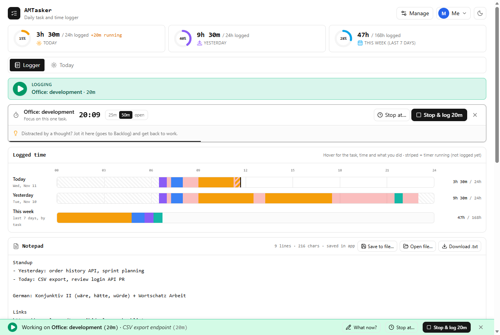

# AMTasker

A local-first daily task and time logger. Start a timer on a task, and the whole page turns green so you know at a
glance that your time is being logged. When nothing is logged, it turns red. Your data never leaves your browser.



## Features

- **Logger page** (the start page): hours logged today, yesterday and this week with progress rings; 24-hour
  timelines of what you did and when; a notepad; a priorities matrix; a countdown timer; a large "Now" card.
- **Logging at a glance**: a green ▶ strip and status bar while a task is running, a red ■ when nothing is logged.
  The browser tab icon follows, so you can see it from other tabs.
- **Fix the record afterwards**: "Log this time" for work you forgot to start, "Stop at…" for a timer you forgot to
  stop, and "What now?" to note what you are doing within a task.
- **Today page**: plan the day, star up to three focus tasks, plan minutes, mark tasks done and close the day.
- **More pages when you want them**: a Tracker grid (days × tasks), a weekly Review and a TimeSheet. They are hidden
  by default; turn them on in **Manage → View**.
- **Make it yours**: show, hide and reorder the Logger's sections, choose a colour theme, light or dark mode.
- **Profiles**: several people on one computer, each with separate data and an optional PIN.
- **Your data**: stored in the browser (IndexedDB). Export a JSON backup or a CSV of your history at any time.

## Get started

You need [Node.js](https://nodejs.org/) 20.9 or later and [pnpm](https://pnpm.io/).

```sh
pnpm install
pnpm dev
```

Open <http://localhost:3000>. The first start comes with four example tasks (German B2, Morning exercise, Reading,
Office: development); rename or delete them in **Manage → Tasks**.

To build a static site you can host anywhere (or open from a local web server):

```sh
pnpm build   # writes the site to out/
```

Read the [user guide](docs/USER_GUIDE.md) for a walk-through of a typical day.

## Scripts

| Command          | What it does                                                   |
| ---------------- | -------------------------------------------------------------- |
| `pnpm dev`       | Start the development server                                   |
| `pnpm build`     | Static export to `out/`                                        |
| `pnpm test`      | Unit tests (Vitest)                                            |
| `pnpm lint`      | ESLint                                                         |
| `pnpm typecheck` | TypeScript check                                               |
| `pnpm format`    | Format all files with Prettier                                 |
| `pnpm check`     | Everything CI runs: format check, types, lint, tests and build |

## Tech stack

Next.js (App Router, static export, fully client-side), React, TypeScript, Tailwind CSS, IndexedDB via
[`idb`](https://github.com/jakearchibald/idb), [`zod`](https://zod.dev/) for validation, Vitest for tests.

## Project layout

```
app/          Next.js entry: layout, page, global styles and colour themes
components/   UI: app-shell.tsx is the page; one file per tab and panel
lib/model/    Data types and zod schemas (SCHEMA_VERSION)
lib/data/     Storage (repository interface + IndexedDB), backup import/export, example data
lib/domain/   Pure logic without React or storage: timelines, totals, planning, stats (unit tested)
lib/          React hooks (use-app-data.ts owns the app state), profiles, timers, helpers
docs/         User guide and its screenshots
```

## Privacy

AMTasker has no server and no account. Everything you enter stays in your browser's storage on your computer.
Clearing the site's data in your browser deletes it, so export a backup from **Manage → Data** now and then.

## Contributing

Issues and pull requests are welcome. See [CONTRIBUTING.md](CONTRIBUTING.md).

## License

[MIT](LICENSE) © 2026 Asad Mehmood Shah
