# AMTasker user guide

AMTasker answers one question at a glance: **is my time being logged right now?** Start a timer on a task and the
page turns green. Stop it and the page turns red until you start the next one. At the end of the day you can see where
your hours went.

This guide follows one person through a normal Wednesday with four tasks:

| Task                    | When            | Daily target |
| ----------------------- | --------------- | ------------ |
| **Morning exercise**    | every day       | 30 minutes   |
| **German B2**           | every day       | 45 minutes   |
| **Office: development** | Monday – Friday | 6 hours      |
| **Reading**             | every day       | 30 minutes   |

## Contents

1. [First start](#1-first-start)
2. [Set up your tasks](#2-set-up-your-tasks)
3. [A day with AMTasker](#3-a-day-with-amtasker)
4. [Reading the Logger page](#4-reading-the-logger-page)
5. [The Today page](#5-the-today-page)
6. [Make it yours](#6-make-it-yours)
7. [Profiles](#7-profiles)
8. [Your data and backups](#8-your-data-and-backups)
9. [Questions and tips](#9-questions-and-tips)

## 1. First start

Run AMTasker (see [Getting started](../README.md#getting-started) in the README for Linux, macOS and Windows) and open it in your browser. It opens on the **Logger** page.

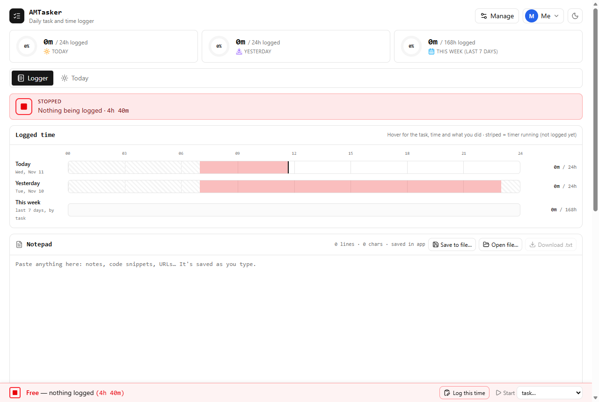

- The **top row** shows hours logged today, yesterday and in the last 7 days. The ring shows the share of the
  24 hours (or 168 hours for the week).
- The **tabs** are Logger and Today. More pages (Tracker, Review, TimeSheet) can be switched on later.
- The **red STOPPED strip** says nothing is being logged, and for how long.
- The **bar at the bottom** is on every page. It shows the same state and lets you start a timer from anywhere.

## 2. Set up your tasks

The first start comes with the four example tasks above. To change them, or to add your own, click **Manage** (top
right) and stay on the **Tasks** tab.

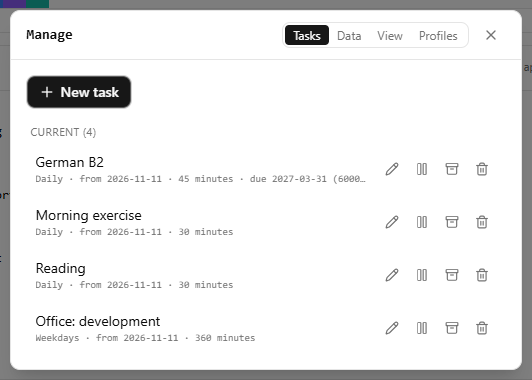

Click **New task** to add one. Only the name is required.

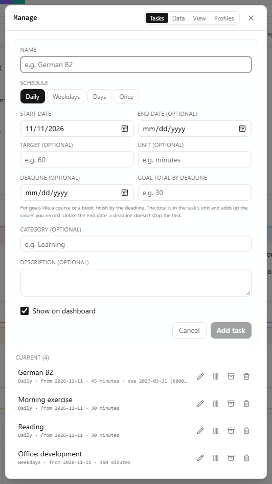

- **Schedule**: every day, weekdays, chosen days of the week, or once.
- **Target and unit**: for example `45` `minutes`. Time you log is counted against it.
- **Deadline and goal total**: for a goal with an end date. For example, give German B2 the exam date as the deadline
  and `6000` minutes (100 hours) as the total. AMTasker then shows the days left and how much you have done.
- Use the icons next to a task to **edit**, **pause**, **archive** or **delete** it. Archiving keeps its history;
  deleting removes it after you confirm.

## 3. A day with AMTasker

### 06:30 · Morning exercise: start a timer

In the bottom bar, choose the task under **Start**. The page turns green at once, the timer bar appears under the
tabs, and the browser tab's icon changes to a green ▶.

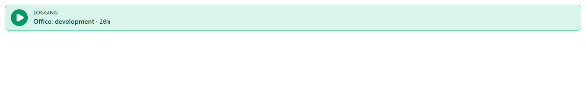

The timer bar offers `25m`, `50m` or `open` as the session length. At the end of a 25 or 50 minute session you hear a
chime, and the timer keeps counting. When you are done, click **Stop & log**. The time is saved as a block on the
timeline and counted towards the task for today. The **✕** discards the session without logging.

### 07:15 · German B2: note what you are doing

Start German B2 the same way. To record what you are working on within the task, click **What now?** in the bottom
bar and type a short note, for example "Goethe B2 practice test: Lesen, part 2". Add a new note whenever you switch to
something else. The notes show up when you hover over the timeline.

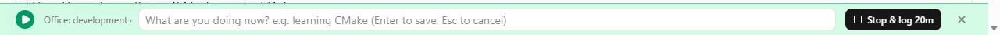

### 08:00 · Commute: nothing logged

You stop the timer and leave for the office. The page turns red and counts how long nothing has been logged. That red
time also shows on the timeline, so gaps are easy to see.

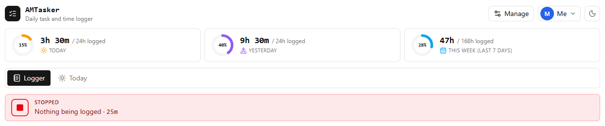

### 09:00 · Office: forgot to start the timer

You started work at 09:00 but only notice at 09:25. In the bottom bar, click **Log this time**.

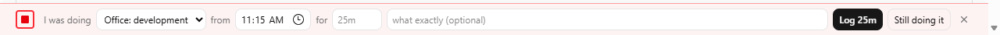

- **I was doing**: the task (it suggests the last one you logged).
- **from**: when you started. **for**: how long, for example `25m` or `1h 15m` (leave it empty for "until now").
- **Log** saves that block. **Still doing it** starts the timer as if you had started it at the "from" time.

### 11:15 · Forgot to stop the timer

You went to a meeting at 11:15 and the timer kept running. Click **Stop at…** in the timer bar and enter either the
time you stopped (`11:15`) or how long you worked (`2h 15m`). Only that much is logged.

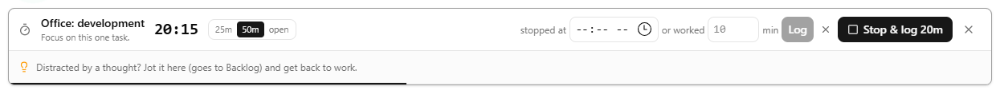

### 21:30 · Reading

Start Reading from the bottom bar, then **Stop & log** when you put the book down. Your day is complete.

## 4. Reading the Logger page

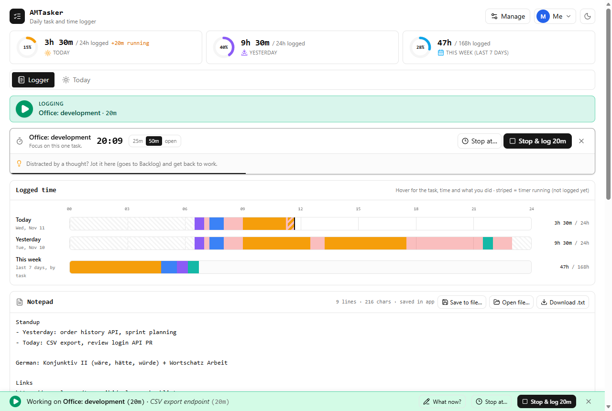

### Logged hours

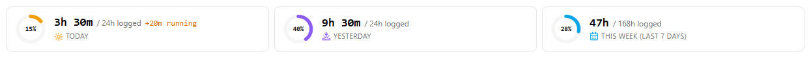

Each card shows the hours logged and a ring with the share of the period. While a timer runs, **Today** also shows the
running time in amber (it is added when you stop the timer).

### Logged time

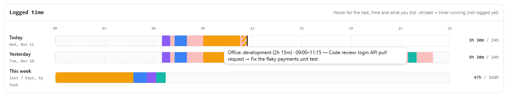

- **Today** and **Yesterday** are 24-hour timelines. Each task has its own colour. Red is time inside your usual day
  with nothing logged, and striped grey is outside it (night). The black line is now, and the striped part in the task
  colour is the timer that is still running.
- **This week** adds up the last 7 days by task.
- **Hover** over a block to see the task, its length and times, and your "What now?" notes.

### Notepad

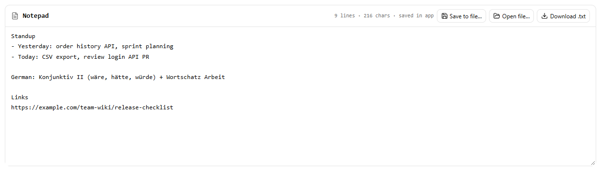

A plain-text scratchpad for anything: stand-up notes, links, vocabulary. It is saved as you type. **Save to file…**
links it to a `.txt` file on your computer that is updated automatically (in Chrome and Edge); **Download .txt** saves
a copy. Drag the bottom edge to change its height; it remembers it.

### Priorities

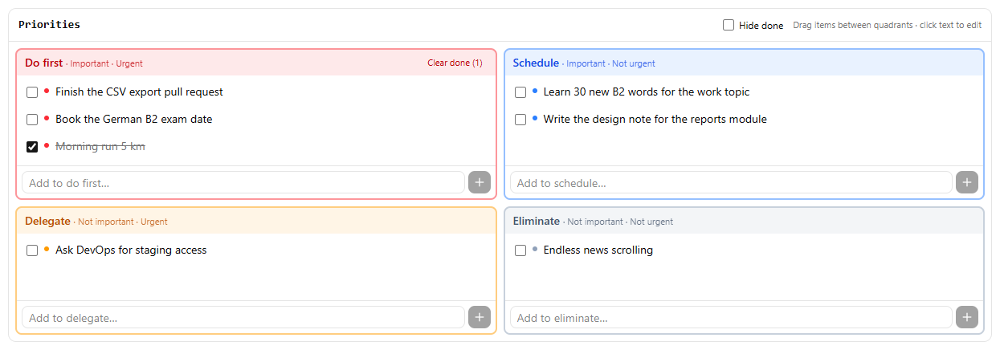

Sort to-dos by how important and how urgent they are: **Do first**, **Schedule**, **Delegate** and **Eliminate**. Type
in a box and press Enter to add. Click a to-do to edit it, tick it when it is done, and drag it to another box (or use
its menu) to move it. **Hide done** hides finished to-dos in all four boxes; **Clear done** removes them from one box.

### Countdown and Now

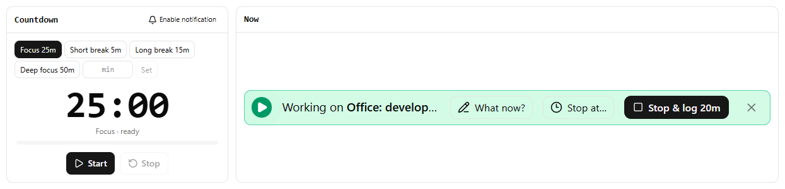

- **Countdown**: a timer for breaks and Pomodoro sessions. Pick a preset, or type any length (`10`, `1h 30m`, `1:30`)
  and click **Set**, then **Start**. When it ends you hear a chime, the browser tab title changes, and you get a
  notification if you allowed them (**Enable notification**). It keeps running if you switch pages.
- **Now**: a large copy of the bottom bar, with the same buttons.

## 5. The Today page

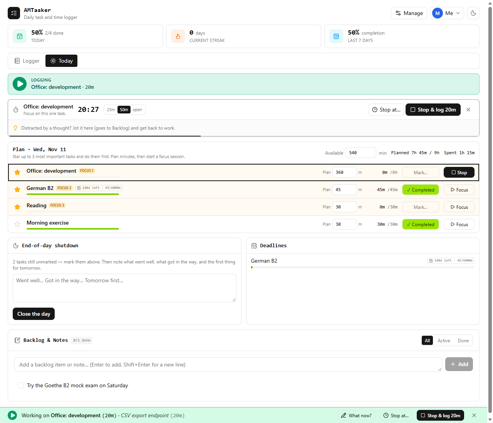

Use it to plan the morning and close the evening.

1. **Available**: how many minutes you have for planned work today.
2. **Star** up to three tasks to do first. They are marked FOCUS 1, 2 and 3.
3. **Plan** minutes per task. The total is compared with the time available.
4. **Focus** starts the timer on a task (the same as Start in the bottom bar).
5. **Mark…** records how it went: Completed, Partial, Not done or Skipped.
6. **End-of-day shutdown**: note what went well, what got in the way and the first thing for tomorrow, then **Close
   the day**.

**Deadlines** lists tasks with a deadline and their progress. **Backlog & Notes** is a place for ideas you want to do
later. Thoughts you type into the timer bar while working ("Distracted by a thought?") also land here.

## 6. Make it yours

Everything below is in **Manage → View** and is saved for your profile.

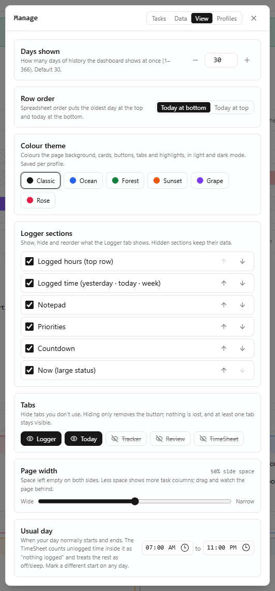

- **Colour theme**: Classic, Ocean, Forest, Sunset, Grape or Rose. It colours the background, cards and buttons. Use
  the sun/moon button at the top right for light or dark mode.
- **Logger sections**: tick to show or hide a section and use the arrows to change the order. You can also reach this
  from **Customize Logger** at the bottom of the Logger page. Hidden sections keep their data.
- **Tabs**: show or hide pages. The **Tracker** (a grid of days × tasks), **Review** (your week: planned vs spent,
  completion, shutdown notes) and **TimeSheet** (a 24-hour timeline per day, where you can add, edit and delete
  blocks) are hidden at first. At least one tab always stays visible.
- **Page width** and **Usual day** (when your day normally starts and ends; time outside it is not counted as
  "nothing logged").

| Forest, light mode                       | Ocean, dark mode                                  |
| ---------------------------------------- | ------------------------------------------------- |
| 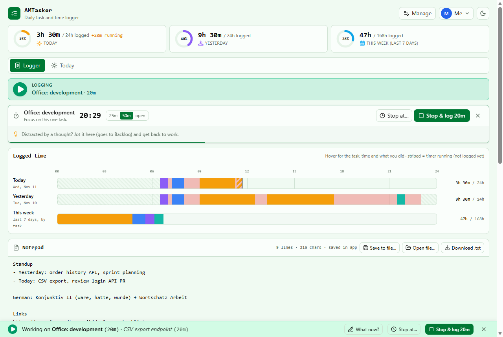 | 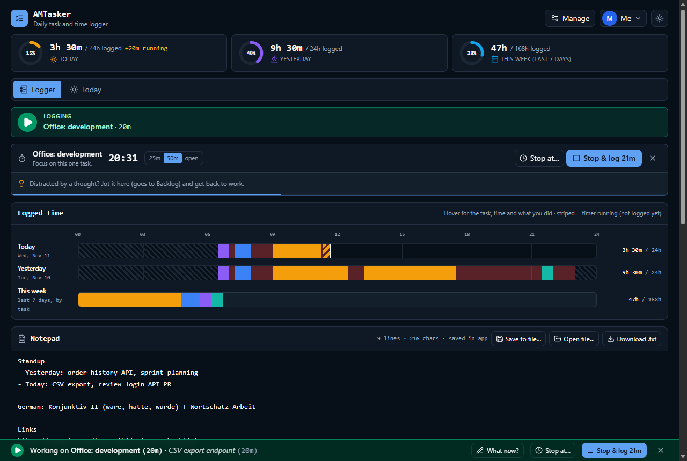 |

## 7. Profiles

If several people use the same computer, each can have a profile with completely separate tasks, logs and settings.
Click your name at the top right to switch, add a profile or lock the app. In **Manage → Profiles** you can rename a
profile, change its colour, set an optional 4–6 digit PIN or delete it.

The PIN keeps others from opening your profile by accident. It does not encrypt your data.

## 8. Your data and backups

AMTasker has no server and no account. Your data is stored in this browser on this computer (IndexedDB).

- **Manage → Data → Backup (JSON)** downloads a file with everything. **Choose backup file…** under _Restore from
  backup_ loads one back; it shows what the file contains and asks before replacing your data.
- **History (CSV)** gives you your history as a spreadsheet: one row per day, one column per task.
- Clearing the browser's site data, or using a private window, means starting empty. Export a backup now and then.
- Another browser or computer has its own separate data. Use a backup to move it.

## 9. Questions and tips

**The bottom bar says "Free — nothing logged" but I was working.**
Use **Log this time** to assign that time to a task.

**I logged a block with the wrong time.**
Turn on the **TimeSheet** tab (Manage → View → Tabs). Open the day's details and edit (✎) or delete the block.

**I don't get a notification when the countdown ends.**
Click **Enable notification** on the Countdown and allow notifications for the site in your browser. Without
permission you still hear the chime and see the tab title change.

**The timeline shows the night as striped grey.**
That is time outside your usual day. Change your usual start and end in **Manage → View → Usual day**.

**What happens on the days the clocks change?**
Times are placed by the clock, so 23:30 is shown at 23:30 even on a 23- or 25-hour day.
